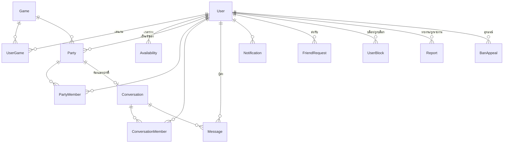

# MATCHFOUND — สรุปโปรเจกต์ (สำหรับเตรียมพรีเซนต์)

แพลตฟอร์มหาเพื่อนเล่นเกมและสร้างปาร์ตี้ ผู้ใช้ล็อกอินด้วย Discord สร้าง/ค้นหาห้อง แชทกัน เพิ่มเพื่อน และมีระบบดูแลชุมชน (รายงาน, กรองคำหยาบ, แบน/อุทธรณ์)

> เอกสารนี้สรุปจากโค้ดและ schema ที่อยู่ใน repo ณ วันที่เขียน (8 พ.ย. 2026) ส่วนที่ยังไม่ได้ตรวจหรือยังไม่ทำ จะระบุไว้ในหัวข้อ "ข้อจำกัด"

---

## 1. เทคโนโลยีที่ใช้

| ส่วน | เทคโนโลยี |
|---|---|
| Frontend | React 18, TypeScript, Vite, Tailwind CSS, lucide-react |
| Backend | Node.js, Express, TypeScript |
| ฐานข้อมูล | PostgreSQL + Prisma ORM |
| Realtime | Socket.IO (แชทและจำนวนผู้ออนไลน์) |
| ล็อกอิน | Discord OAuth 2.0 + JWT (ไม่มีรหัสผ่านในระบบ) |
| ความปลอดภัย | Rate limit, ตรวจข้อมูลด้วย zod, middleware สำหรับ auth/admin |

---

## 2. ฟีเจอร์หลัก

- **ล็อกอินด้วย Discord** (`/api/auth`)
- **โปรไฟล์ผู้เล่น**: เกมที่เล่น, แรงก์, แพลตฟอร์ม, สไตล์การเล่น, เปิดไมค์หรือไม่, ภาษา, เวลาว่างรายสัปดาห์ (`/api/users`)
- **ปาร์ตี้**: สร้าง/ค้นหา/ขอเข้าร่วม/อนุมัติ/เตะสมาชิก, กำหนดช่วงแรงก์, ภาษา, ภูมิภาค, บังคับไมค์, ดันห้อง (bump) (`/api/parties`)
- **แชท**: ห้องแชทของปาร์ตี้และแชทส่วนตัว แบบเรียลไทม์ (`/api/chat` + Socket.IO)
- **เพื่อน**: ส่ง/รับคำขอเป็นเพื่อน (`/api/friends`)
- **แจ้งเตือน**: คำขอเข้าร่วมปาร์ตี้, ข้อความใหม่, คำขอเป็นเพื่อน ฯลฯ
- **ค้นหาห้องด้วยประโยค** (`/api/ai/match-search`): อนุมานเกมและความต้องการไมค์จากข้อความ แล้วให้คะแนนความเข้ากัน
- **ความปลอดภัยของชุมชน** (`/api`): บล็อกผู้ใช้, รายงานผู้ใช้ (5 หมวด), กรองคำหยาบไทย/อังกฤษ พร้อมระบบเตือนและ mute แชท, แบนบัญชี, ยื่นอุทธรณ์การแบน, หน้า Admin จัดการรายงาน
  - ถ้ามี `OPENAI_API_KEY` จะใช้ OpenAI moderation ถ้าไม่มีจะใช้ตัวกรองคีย์เวิร์ดในเครื่อง

---

## 3. ฐานข้อมูล

มี **14 ตาราง**, **12 enum**, **foreign key 20 ตัว**

### 3.1 แผนผังความสัมพันธ์



### 3.2 หน้าที่ของแต่ละตาราง

| ตาราง | หน้าที่ |
|---|---|
| `User` | บัญชีผู้ใช้ (discordId, โปรไฟล์, สถานะแบน, mute แชท) |
| `Game` | รายชื่อเกมและลำดับแรงก์ |
| `UserGame` | เกมที่ผู้ใช้เล่น (User ↔ Game แบบ many-to-many) |
| `Availability` | ช่วงเวลาที่สะดวกเล่นในแต่ละวัน |
| `Party` | ห้อง/ปาร์ตี้ที่สร้าง |
| `PartyMember` | สมาชิกและคำขอเข้าร่วม (User ↔ Party แบบ many-to-many) |
| `Conversation` | ห้องแชท (ของปาร์ตี้ หรือแชทส่วนตัว) |
| `ConversationMember` | สมาชิกห้องแชทและเวลาอ่านล่าสุด |
| `Message` | ข้อความ |
| `Notification` | การแจ้งเตือน (payload เป็น JSON) |
| `FriendRequest` | คำขอเป็นเพื่อน |
| `UserBlock` | การบล็อกผู้ใช้ |
| `Report` | รายงานผู้ใช้ (หมวด: PROFANITY, TOXIC, AFK, DISRUPTION, HARASSMENT) |
| `BanAppeal` | คำขออุทธรณ์การแบน |

### 3.3 พฤติกรรมตอนลบข้อมูล

- ลบ `User` แล้วข้อมูลที่เกี่ยวข้องถูกลบตาม (`CASCADE`) เช่น ปาร์ตี้ ข้อความ การแจ้งเตือน
- ลบ `Game` ที่ยังมี `Party` อ้างอิงอยู่ **ไม่ได้** (`RESTRICT`) เพื่อกันปาร์ตี้ค้าง

---

## 4. ไฟล์ SQL ในโปรเจกต์

| ไฟล์ | คืออะไร |
|---|---|
| `prisma/schema.prisma` | ต้นฉบับของโครงสร้างฐานข้อมูล (แก้ที่นี่เป็นหลัก) |
| `prisma/migrations/*/migration.sql` | ประวัติการเปลี่ยนแปลง ⚠ ดูหมายเหตุด้านล่าง |
| `prisma/matchfound_compact.sql` | SQL อ้างอิง 132 บรรทัด สำหรับสร้างฐานข้อมูลเปล่า |

**ทำไมไฟล์ SQL ที่ export จาก pgAdmin ถึงยาว 1,294 บรรทัดทั้งที่มีแค่ 14 ตาราง:** เพราะ pg_dump ใส่คอมเมนต์ราว 500 บรรทัด และบรรทัดว่างราว 370 บรรทัด เหลือโค้ดจริงราว 415 บรรทัด ซึ่งยาวเพราะแยกเขียน sequence และ default ทีละส่วน

**`matchfound_compact.sql`** ผ่านการทดสอบกับ PostgreSQL จริงโดยเทียบกับ dump ต้นฉบับ: คอลัมน์ทั้ง 102 คอลัมน์ ชนิดข้อมูล ค่าเริ่มต้น index primary key และ foreign key เหมือนกัน ความต่างอย่างเดียวคือชื่อ constraint/index ที่ PostgreSQL ตั้งให้เอง และ unique ถูกสร้างเป็น constraint แทน unique index (บังคับค่าไม่ซ้ำเหมือนกัน)

> ⚠ **หมายเหตุเรื่อง migration:** `migrations/20261012152756_init/migration.sql` มีแค่คอมเมนต์ และ migration ที่เหลือเป็น `ALTER TABLE` ล้วน ไม่มีไฟล์ไหนสร้างตารางหลัก ดังนั้นการรัน `prisma migrate deploy` บนฐานข้อมูลใหม่จะ error ให้ใช้ `npx prisma db push` หรือ `matchfound_compact.sql` สร้างโครงสร้างแทน หรือทำ baseline migration ใหม่ (ดูหัวข้อ 6)

---

## 5. วิธีรันโปรเจกต์

**ต้องมี:** Node.js, PostgreSQL, Discord application (สำหรับ OAuth)

```bash
# 1) ตั้งค่า environment
cp .env.example .env
# แก้ DATABASE_URL, JWT_SECRET (อย่างน้อย 32 ตัวอักษร), DISCORD_CLIENT_ID,
# DISCORD_CLIENT_SECRET, ADMIN_DISCORD_IDS

# 2) ติดตั้งและสร้างฐานข้อมูล
npm install
npx prisma generate
npx prisma db push          # สร้างตารางจาก schema.prisma
npx prisma db seed          # ใส่เกมตั้งต้น 4 เกม (Valorant, Apex Legends, CS2, Overwatch 2)

# 3) รัน backend (พอร์ต 5000)
npm run dev

# 4) รัน frontend (พอร์ต 5173) เปิดอีกเทอร์มินัล
cd frontend && npm install && npm run dev
```

- `ADMIN_DISCORD_IDS` คือ Discord ID ของผู้ที่เข้าหน้า Admin ได้
- อย่าเอาไฟล์ `.env` จริงขึ้น GitHub (มี `.env.example` ให้แล้ว)

---

## 6. ข้อจำกัดและสิ่งที่ควรรู้ก่อนพรีเซนต์

- **ยังไม่มีชุดทดสอบอัตโนมัติ** (test) ในโปรเจกต์
- **Migration ไม่ครบ** ตามหัวข้อ 4 ถ้าต้องการให้ `migrate deploy` ใช้ได้ ให้ทำ baseline ใหม่:
  ```bash
  # ใช้กับฐานข้อมูลสำหรับพัฒนาเท่านั้น และสำรองข้อมูลก่อน
  mkdir -p prisma/migrations/0_init
  npx prisma migrate diff --from-empty --to-schema-datamodel prisma/schema.prisma --script > prisma/migrations/0_init/migration.sql
  npx prisma migrate resolve --applied 0_init
  ```
  (ต้องลบ migration เก่าออกก่อน และอย่าใช้ `migrate reset` กับข้อมูลจริง)
- **ค้นหาห้องด้วยประโยค** ใน `ai.route.ts` เป็นการอนุมานด้วยกฎและให้คะแนนแบบกำหนดเอง ไม่ใช่โมเดลภาษา ถ้าถูกถามให้ตอบตามนี้
- **ตัวกรองคำหยาบ** แบบ local ใช้คีย์เวิร์ด อาจพลาดหรือบล็อกผิดได้ ระบบแจ้งเรื่องนี้ในหน้าตั้งค่า
- ใน `ai.route.ts` มีตัวแปร `matches` (ประมาณบรรทัด 53-61) ที่คำนวณแต่ไม่ได้ใช้ อาจเป็นฟีเจอร์ "แนะนำผู้เล่น" ที่ยังทำไม่เสร็จ
- เอกสาร `red.md` (handoff) พูดถึงฟีเจอร์ที่ **ยังไม่มีในโค้ดปัจจุบัน** เช่น ทีม, ทัวร์นาเมนต์, FACEIT, Reputation ให้ถือเป็นแผนอนาคต ไม่ใช่ของที่ทำเสร็จแล้ว

---

## 7. ประเด็นที่ใช้พูดตอนพรีเซนต์

1. **ปัญหา:** หาเพื่อนเล่นเกมที่แรงก์ เวลา และภาษาเข้ากันได้ยาก และห้องสาธารณะมักเจอผู้เล่น toxic
2. **ทางแก้:** ปาร์ตี้ที่กรองตามเกม แรงก์ ภาษา ไมค์ + แชทเรียลไทม์ + ระบบดูแลชุมชนในตัว
3. **จุดเด่นด้านความปลอดภัย:** ล็อกอินผ่าน Discord ไม่เก็บรหัสผ่าน, rate limit, กรองคำหยาบไทย/อังกฤษ, mute แชทอัตโนมัติ, แบนและอุทธรณ์โดยแอดมินตัดสิน (ไม่แบนอัตโนมัติ)
4. **ออกแบบฐานข้อมูล:** 14 ตาราง มี many-to-many 2 จุด (User↔Game, User↔Party) ใช้ `CASCADE` กับข้อมูลที่ผูกกับผู้ใช้ และ `RESTRICT` กับ Game เพื่อกันข้อมูลหาย
5. **งานต่อยอด:** ทีมถาวร ทัวร์นาเมนต์ ระบบ reputation การแนะนำผู้เล่นที่เข้ากัน และชุดทดสอบ

### คำถามที่อาจโดนถาม

| คำถาม | แนวตอบ |
|---|---|
| ทำไมใช้ Discord ล็อกอินอย่างเดียว | กลุ่มเกมเมอร์ใช้อยู่แล้ว ไม่ต้องเก็บรหัสผ่านจึงลดความเสี่ยงด้านข้อมูล |
| ทำไมไม่แบนอัตโนมัติ | ตัวกรองอัตโนมัติพลาดได้ จึงให้เตือนและ mute ชั่วคราว ส่วนการแบนให้แอดมินตัดสินและเปิดช่องอุทธรณ์ |
| ถ้าลบผู้ใช้ ข้อมูลเขาไปไหน | ถูกลบตามด้วย CASCADE (ปาร์ตี้ที่เป็นเจ้าของ ข้อความ การแจ้งเตือน ฯลฯ) |
| ทำไมตารางเยอะ | แยกตามหน้าที่ (โปรไฟล์ ปาร์ตี้ แชท ความปลอดภัย) เพื่อไม่ให้ข้อมูลซ้ำซ้อน |
| ระบบค้นหาด้วยประโยคใช้ AI ไหม | เป็นการอนุมานด้วยกฎ ส่วน OpenAI ใช้เฉพาะการตรวจเนื้อหา ถ้าตั้ง API key ไว้ |
